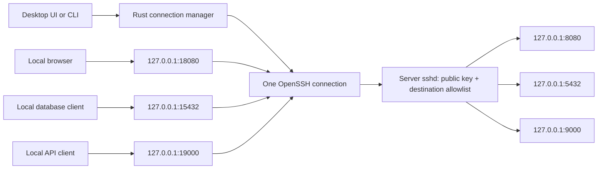

# sservcli

Access several services on one server through one authenticated SSH connection.
sservcli provides a Rust connection manager and CLI, a Tauri 2 desktop interface,
and an Ubuntu server provisioning tool. The server runs ordinary OpenSSH; there
is no additional network daemon or publicly exposed management API.

This is an OpenSSH-based MVP. Web services open in your browser, and database or
TCP services open in a configured local client. The application connects to
services that are **already running**; it does not start server processes or
grant a remote shell.

## Architecture

The recommended setup uses an existing SSH account and its already-authorized
private key or Agent. The server provisioning tool is optional. The desktop app
forwards every enabled service automatically at launch and stays in the tray.

### Quick connection with an existing account

In **Connection settings**, enter your server address, SSH username, optional
fallback addresses, and the trusted server host public key. Enter an existing
private-key path, or leave it empty to use SSH Agent/default identities. Add your
service ports and click **Save & connect all**. There is no need to create another
server account or manually edit `known_hosts` when the existing account already
allows TCP forwarding.

The host public key identifies the server; your private key or Agent authenticates
the account. Obtain the host `.pub` line and verify its fingerprint through a
trusted administrator channel:

```sh
cat /etc/ssh/ssh_host_ed25519_key.pub
ssh-keygen -lf /etc/ssh/ssh_host_ed25519_key.pub
```

Alternatively, create the profile from a trusted host-public-key file:

```sh
sservcli init --host 192.0.2.10 --fallback-hosts 192.0.2.11,192.0.2.12 \
  --user ubuntu --host-key server-host-key.pub --identity "~/.ssh/id_ed25519"
sservcli connect --config services.json
```

Omit `--identity` to use Agent/default identities. `init` refuses to overwrite
an existing profile and does not modify the server. The initial service forwards
local port `18080` to server port `8080`; override these with `--local-port` and
`--remote-port`. `--port` selects the SSH port, and `--config` selects the output
file. The desktop form can add multiple services without editing JSON.

The saved profile is restored on the next desktop launch and all enabled services
connect automatically in the background. **Local services…** in the tray opens
the endpoint list. Closing the window keeps forwarding active; **Disconnect**
stops the tunnel and **Quit** exits. Launching the desktop app a second time opens
the existing instance. A terminal connection failure shows the window for diagnosis.
The CLI's `connect` command remains attached to its terminal until Ctrl+C; the
desktop executable provides the background/tray lifecycle.

### Fallback IP array and inline host key

Simple connections store this SSH section in the profile:

```json
"ssh": {
  "host": "192.0.2.10",
  "fallback_hosts": ["192.0.2.11", "192.0.2.12"],
  "port": 22,
  "user": "ubuntu",
  "identity_file": null,
  "host_public_key": "ssh-ed25519 REPLACE_WITH_THE_REAL_SERVER_PUBLIC_KEY"
}
```

Use the actual complete host `.pub` line. The primary address is tried first,
followed by the array in order. All addresses share one SSH port, username,
identity, and pinned host key; use alternative routes to the same trusted server.
Different host keys are rejected on every address. There may be at most 16 unique
addresses including the primary. On startup the list is tried once; after an
interrupted established connection, bounded recovery cycles start with the next
address in the list. All services move together to the selected address.

Choose exactly one verification source: `host_public_key` or `known_hosts_file`.
The inline key is validated with `ssh-keygen`; a private temporary host-key file
covers all candidate addresses and is removed on normal disconnect. Your personal
SSH files are not modified. Advanced `known_hosts_file` profiles must contain
trusted entries for each fallback address. `command` is available for those
advanced profiles; use `connect` to manage the temporary file for inline-key profiles.

The service list shows local addresses and forwarding state. **Forwarding** means
SSH authenticated and its local listeners are ready, rather than an application
health check. Database/TCP clients can connect to those local ports. An optional
`launch` array enables the corresponding external-client launch button.

### Transport



| Service | Server destination | Local endpoint |
| --- | --- | --- |
| Web dashboard | `127.0.0.1:8080` | `http://127.0.0.1:18080/` |
| PostgreSQL | `127.0.0.1:5432` | `127.0.0.1:15432` |
| REST API | `127.0.0.1:9000` | `http://127.0.0.1:19000/docs` |

All enabled forwards belong to a single SSH process. On Unix, a private OpenSSH
control socket confirms successful authentication and listener setup. On Windows,
the native TCP table must show that this SSH process owns every enabled loopback
listener; an unrelated process listening on the same port cannot satisfy this
check. Keepalives detect broken transports. Interrupted connections use bounded exponential backoff;
initial failures try the ordered address list once and then stop.

## Requirements

- **CLI:** Windows 10/11, Linux, or macOS, an OpenSSH client, Rust 1.75+
  and Cargo to build. The core has no GTK, Node.js, or Tauri dependency.
- **Desktop:** Windows 10/11, Linux, or macOS, current stable Rust (at least 1.90 for the current single-instance plugin), Node.js 20.19+ or 22.12+,
  and the [Tauri 2 platform prerequisites](https://v2.tauri.app/start/prerequisites/).
  Linux requires the GTK/WebKit development libraries listed there. Current
  Tauri dependencies may need a newer compiler than Tauri's original minimum.
  Windows development requires Microsoft C++ Build Tools, an MSVC Rust toolchain,
  and the WebView2 runtime described in those prerequisites.
- **Optional server provisioning:** Ubuntu with Python 3.10+, OpenSSH server, systemd,
  `useradd`, `userdel`, `pkill`, and root access. The default systemd unit is `ssh`.
- **Service clients:** Your browser, `psql`, or any other configured executable.

Windows uses native OpenSSH without Unix control sockets. The Windows optional
OpenSSH Client feature is preferred over Git/WSL SSH wrappers; portable native
`ssh.exe` on `PATH` is used if the Windows system copy is absent. Server
provisioning remains an Ubuntu administrator task; Windows clients connect to
the same server and use the same destination restrictions.

## Optional setup with a restricted server account

### One command: server setup and a build-ready Windows source ZIP

Configure two values: `PUBKEY_FILE`, the existing Windows client's **Ed25519
public key**, and `CONFIG`, the services JSON file. Start from the example:

```sh
cp client/examples/services.json services.json
# Edit services.json: ssh.host, ssh.fallback_hosts, ssh.user, and service ports.
make bundle PUBKEY_FILE=/path/to/client-id_ed25519.pub CONFIG=services.json
```

All connection settings come from `CONFIG`: server address, ordered fallback
array, SSH port, new forwarding-only username, existing Windows identity path,
and service definitions. Set `ssh.identity_file` to `null` for Agent/default
identities, or to an existing Windows-side path such as `~/.ssh/id_ed25519`.
Set `ssh.host` to a real address rather than the example hostname. The SSH port
must already match the server's sshd configuration.

The command validates the JSON and public key, gathers the local source/build
inputs, enables/starts OpenSSH and creates missing host keys, creates the new
account named by `ssh.user`, registers the client public key, and writes
`dist/sservcli-windows-<ssh.user>-source.zip`. The generated client profile uses
the server's actual public host key automatically, replacing the example's
`known_hosts_file` setting. Privileged account setup uses `sudo`.

Packaging requires Python 3.10+, Make, OpenSSH server/client, and sudo on Ubuntu.
It requires no `gh`, Git checkout/commit/push, Rust/Cargo, Node.js, or Windows
build on the server. Local uncommitted source edits are included. The ZIP uses
an explicit build-input allowlist, excluding `.git`, build caches, generated
files, and private key directories. Your existing client private key stays on
Windows and is never copied into the archive.

Preview without changing accounts, SSH services, or writing the final ZIP:

```sh
make bundle PUBKEY_FILE=/path/to/client.pub CONFIG=services.json DRY_RUN=1
```

The ZIP contains the Rust workspace, desktop HTML/CSS/JavaScript, dependency
lockfiles, required icons/capabilities, the prepared `services.json`, server host
public key, `Build.cmd`, `Start.cmd`, a short README, and SHA-256 checksums.
After extracting it on Windows:

1. Install current stable Rust with the MSVC toolchain, Node.js, Microsoft C++
   Build Tools, WebView2, and native OpenSSH Client.
2. Run **Build.cmd** in Windows Terminal. It installs the declared npm packages,
   builds the CLI and desktop locally with the lockfiles, and places both `.exe`
   files beside `services.json`. Cargo/npm need their normal dependency access.
3. Run **Start.cmd** to load that profile and forward every enabled service in
   the background. Your existing identity or SSH Agent must be usable on Windows.

For an already-built local binary ZIP/directory, `WINDOWS_ARTIFACT` is optional;
it must contain Windows x64 `sservcli.exe` and `sservcli-desktop.exe`. This mode
also uses no remote build. `BUNDLE_OUTPUT` overrides the destination ZIP, and
`HOST_KEY_FILE` selects a nondefault active server host public key. Existing
accounts/homes and output ZIPs are refused; choose a new `ssh.user` or output
path. A late packaging failure attempts to remove only the newly created account.

Download using your existing administrator SSH account, because the new
forwarding-only account intentionally has no SFTP/SCP sessions. For example,
from Windows PowerShell (replace the server path and administrator username):

```powershell
scp.exe admin@203.0.113.10:/path/to/sservcli/dist/sservcli-windows-svc_tunnel-source.zip .
Expand-Archive .\sservcli-windows-svc_tunnel-source.zip -DestinationPath .\sservcli-client
.\sservcli-client\Build.cmd
.\sservcli-client\Start.cmd
```

### Individual administration commands

Use this administrator workflow when you want a new forwarding-only account.
Existing SSH accounts that already permit the required forwarding can use the
quick connection above instead.

### 1. Create a client profile and SSH identity

On the client:

```sh
cp client/examples/services.json services.json
ssh-keygen -t ed25519 -f ~/.ssh/sservcli -C sservcli
ssh-add ~/.ssh/sservcli
```

Edit `services.json`: set `ssh.host` to your real server and `ssh.identity_file`
to `~/.ssh/sservcli`. Keep the private key on the client. An encrypted private key
must be unlocked in your local SSH Agent before connecting; sservcli never asks
for a passphrase. Set `identity_file` to `null` to use identities from SSH Agent
without selecting a particular file. Agent authentication does not require agent
forwarding, which remains disabled.

### 2. Provision the server

Transfer the public key (`sservcli.pub`), the profile, and this repository to the
server using an existing administrator connection. Client filesystem paths in
the profile are not used by the server tool. Review the destinations before
installing:

```sh
python3 server/sservcli_server.py render --config services.json
sudo python3 server/sservcli_server.py install \
  --config services.json --public-key /path/to/sservcli.pub
```

The tool creates a new `svc_tunnel` account, installs a root-controlled public key,
appends a managed SSH policy, checks `sshd -t` and effective `sshd -T` settings,
and reloads the SSH service. Existing users, homes, or managed account records
are never reused. Validation or reload failure restores the previous SSH config
and attempts to remove the newly created account. Installation does not change
your firewall or start any application service.

The existing Makefile interface is also available:

```sh
sudo make create PUBKEY_FILE=/path/to/sservcli.pub \
  PERMIT_OPEN="127.0.0.1:8080 127.0.0.1:5432 127.0.0.1:9000"
```

`make create` uses `TUNNEL_USER` and `PERMIT_OPEN`; it does not read `CONFIG`.
Use the Python command above when the JSON profile is your source of truth.
Only plain Ed25519 public keys are accepted by the provisioning tool.

### 3. Install a verified server host key

Obtain `/etc/ssh/ssh_host_ed25519_key.pub` and its fingerprint through your
administrator's trusted channel. The administrator can display the fingerprint:

```sh
sudo ssh-keygen -lf /etc/ssh/ssh_host_ed25519_key.pub
```

After verifying the transferred public key and fingerprint, install it on the
client. This example assumes the trusted copy is named `server-host-key.pub`:

```sh
ssh-keygen -lf server-host-key.pub
mkdir -p ~/.ssh
chmod 700 ~/.ssh
touch ~/.ssh/known_hosts
chmod 600 ~/.ssh/known_hosts
awk -v host="server.example.com" '{ print host " " $1 " " $2 }' \
  server-host-key.pub >> ~/.ssh/known_hosts
```

Replace the hostname with exactly `ssh.host`. For a nonstandard SSH port, use
`[server.example.com]:2222` as the host field. Keep `known_hosts_file` pointed at
this file. Unknown and changed host keys fail closed. The application never
automatically trusts scanned keys or edits your host-key database.

### 4. Run the client

```sh
cargo build --release
./target/release/sservcli check --config services.json
./target/release/sservcli list --config services.json
./target/release/sservcli connect --config services.json
```

Keep the client running while using your services. Press Ctrl+C to close the
connection and release all local ports. Open a service as soon as the tunnel is
ready:

```sh
./target/release/sservcli connect --config services.json --open dashboard
```

`--open` runs once after the initial connection, not after every reconnect.
Inspect the equivalent standalone SSH command without connecting:

```sh
./target/release/sservcli command --config services.json
```

### 5. Run the desktop interface

After installing Tauri's platform prerequisites:

```sh
cd client/desktop
npm ci
npm run dev
```

Open **Connection settings > Advanced**, enter the profile's filesystem path, and click
**Load profile**. The built-in editor can validate and save a profile, including
its per-service `enabled` settings. Disconnect before editing. In **Services**,
click **Connect server**, then **Open service** or **Launch client**. The
**Connection log** shows the last 200 SSH messages in memory. The profile is
remembered and reconnects at the next launch; close the window to keep it in the
tray, or use **Quit** in the tray menu to stop all forwarding.

`npm run build` produces the native executable in
`client/desktop/src-tauri/target/release/`. Installer bundling is disabled; code
signing and platform installers are outside this MVP. Remote service pages open
in an external browser and do not receive access to the Tauri IPC bridge.

The default PostgreSQL example launches `psql`, which works in a terminal. From
the desktop, choose a GUI database client or an installed terminal emulator:

```json
"launch": ["x-terminal-emulator", "-e", "psql", "-h", "{host}", "-p", "{port}", "-U", "app", "app"]
```

### Windows setup (PowerShell)

Enable the **OpenSSH Client** optional feature if `ssh.exe -V` is unavailable.
Microsoft documents installation in its
[OpenSSH for Windows guide](https://learn.microsoft.com/en-us/windows-server/administration/openssh/openssh_install_firstuse).
In an administrator PowerShell session:

```powershell
Add-WindowsCapability -Online -Name OpenSSH.Client~~~~0.0.1.0
Set-Service -Name ssh-agent -StartupType Automatic
Start-Service ssh-agent
```

Back in your normal PowerShell session, create your client identity and profile:

```powershell
New-Item -ItemType Directory -Force "$env:USERPROFILE/.ssh" | Out-Null
ssh-keygen.exe -t ed25519 -f "$env:USERPROFILE/.ssh/sservcli" -C sservcli
ssh-add.exe "$env:USERPROFILE/.ssh/sservcli"
Copy-Item client/examples/services.windows.json services.json
```

Set the real server hostname in `services.json`, then provision the Ubuntu server
with your public key as described above. The
[Windows example](client/examples/services.windows.json) launches PostgreSQL in
Windows Terminal (`wt.exe`) and expects `psql.exe` on `PATH`. Install those tools
or replace `launch` with your database client's executable and arguments. A GUI
client can be specified using an absolute executable path, such as
`C:/Program Files/YourClient/client.exe`.

Obtain and verify the server host public key and fingerprint through the same
trusted administrator channel described in step 3. After verifying the trusted
copy named `server-host-key.pub`, add its key to your Windows host-key database:

```powershell
ssh-keygen.exe -lf .\server-host-key.pub
$keyFields = (Get-Content .\server-host-key.pub -Raw).Trim() -split '\s+'
$entry = 'server.example.com {0} {1}' -f $keyFields[0], $keyFields[1]
Add-Content -Path "$env:USERPROFILE/.ssh/known_hosts" -Value $entry -Encoding ascii
```

Replace the hostname; for a nonstandard port, use `[server.example.com]:2222`.
Then build and connect:

```powershell
cargo build --release --locked
.\target\release\sservcli.exe check --config services.json
.\target\release\sservcli.exe connect --config services.json --open dashboard
```

Ctrl+C or Ctrl+Break disconnects and releases the forwarded ports. The managed
SSH process belongs to a Windows job that also terminates it if the application
is closed abruptly. Background SSH processes run without extra console windows.

For the desktop app, install the
[Windows Tauri prerequisites](https://v2.tauri.app/start/prerequisites/#windows),
then run:

```powershell
Set-Location client/desktop
npm.cmd ci
npm.cmd run dev
# Build the standalone executable:
npm.cmd run build
```

The executable is `client/desktop/src-tauri/target/release/sservcli-desktop.exe`.
Its settings screen accepts a Windows profile path such as
`C:/Users/YourName/services.json`. Browser services use the Windows default
HTTP(S) association directly, including URLs with query strings and Unicode.
The `command` subcommand prints PowerShell quoting on Windows.

## Profile reference

See [`client/examples/services.json`](client/examples/services.json) for the
complete dashboard, PostgreSQL, and API example. Unknown fields are rejected by
the client to catch misspelled settings.

| Field | Meaning |
| --- | --- |
| `version` | Schema version; currently `1` |
| `name` | Display name for this server |
| `ssh.host`, `ssh.port`, `ssh.user` | Primary hostname/IP, port (default `22`), existing or dedicated account |
| `ssh.fallback_hosts` | Ordered array of alternative addresses; default empty |
| `ssh.identity_file` | Private key or public identity file; `null` for agent selection |
| `ssh.host_public_key` | Trusted inline server host public key; manages verification automatically |
| `ssh.known_hosts_file` | Advanced verified host-key database, as an alternative to `host_public_key` |
| `reconnect.enabled` | Retry interrupted established connections; default `true` |
| `reconnect.max_attempts` | Total retries per Connect action; default `5`, maximum `100` |
| `reconnect.initial_delay_secs` | First retry delay; default `2` |
| `reconnect.max_delay_secs` | Backoff cap; default `30`, maximum `300` |
| `services[].id`, `name` | Unique service id and display name |
| `services[].kind` | `web`, `api`, `database`, or `tcp` |
| `services[].remote_host` | Must be the literal `127.0.0.1` |
| `services[].remote_port` | Server port, `1–65535` |
| `services[].local_port` | Unique unprivileged client port, `1024–65535` |
| `services[].enabled` | Include in this connection; default `true` |
| `services[].scheme`, `path` | Browser URL scheme (`http`/`https`) and path; defaults `http`, `/` |
| `services[].launch` | Optional local executable/argument array; no shell expansion |

SSH paths are relative to the profile's directory; `~/` expands to `HOME` on Unix
and `USERPROFILE` on Windows (falling back to `HOME` if needed). Windows also
accepts `~\`, drive-absolute paths, and UNC paths. Prefer forward slashes in JSON,
for example `C:/Users/Your Name/.ssh/known_hosts`; JSON backslashes must be escaped.
Windows drive-relative paths such as `C:keys/id_ed25519` are rejected.
Other environment-variable and SSH `%` token expansions are not
supported. SSH config files are deliberately ignored (`-F none`), so aliases,
ProxyJump, extra forwards, and `ProxyCommand` are not inherited.

Launch arguments accept `{host}`, `{port}`, and `{url}`. Executables are resolved
through your local `PATH` or an explicit path. Profiles with launch commands are
trusted local code: review them before opening a service. Store database and API
credentials in the service's own client or keychain, rather than in this file.
Web/API services without a launch array use the native default browser on
Windows, `xdg-open` on Linux, or `open` on macOS; database/TCP services require a
launch array to use the launch button.

When using a restricted server account, changing a client's destination does not
authorize it on the server. The server
renderer includes **all** listed services, even those disabled in the UI; the
`enabled` flag is a client preference. To change authorization in this version,
remove and reinstall the managed account with the revised profile. This
disconnects its users. Use separate accounts/profiles for different access roles.

## Server administration and security

The generated policy enforces public-key authentication, `MaxSessions 0`, local
TCP forwarding only, and an exact `PermitOpen` allowlist. It disables password
and keyboard-interactive login, agent/X11/Unix-socket forwarding, PTYs, tunnels,
user RC execution, and reverse listeners. The authorized key independently uses
`restrict,port-forwarding,permitopen="..."` restrictions. OpenSSH documents that
[`MaxSessions 0` permits forwarding while denying shell and subsystem sessions](https://man.openbsd.org/sshd_config.5#MaxSessions).

Inspect the effective policy for your real client source address, especially if
the server already has `Match`, `Include`, `AllowUsers`, or `DenyUsers` rules:

```sh
sudo python3 server/sservcli_server.py audit --config services.json \
  --client-address 203.0.113.10
```

The installer audits `127.0.0.1` unless you pass `--client-address`. This checks
one connection context, not every possible address-specific Match rule.
Override `--sshd-config` or `--ssh-service` as needed. Concurrent provisioning
operations are serialized with a file lock. Root-owned metadata in
`/var/lib/sservcli` identifies accounts created by this tool.

Remove a managed account, its home, and its policy:

```sh
sudo python3 server/sservcli_server.py remove --user svc_tunnel
# Or: sudo make delete TUNNEL_USER=svc_tunnel
```

Removal denies new authentication, reloads the policy, stops existing account
processes, and deletes the managed account. Modified account identities or edited
managed blocks are refused. If policy cleanup fails after deletion, a denying
block and metadata remain for administrator recovery. Accounts created by the
original Makefile's `# BEGIN forwarding-only` policy are not adopted or deleted
by this tool; migrate them manually or use a new dedicated username.

Bind server applications to loopback and expose only SSH through your firewall.
SSH protects transport and restricts destinations; each application still needs
its own authentication and authorization. Other processes running on the client
can reach its loopback ports, so service credentials remain necessary.

**Connected** means SSH authentication and listener setup succeeded. It does not
mean that a destination accepts connections or that an application is healthy.
OpenSSH's [`ExitOnForwardFailure` does not test ultimate destinations](https://man.openbsd.org/ssh_config.5#ExitOnForwardFailure).
Applications may need to reconnect or reload after a transport interruption.

## Development and verification

```sh
make check        # Example validation, policy rendering, JavaScript syntax
make test         # Rust unit tests + Python server transaction tests
make integration  # Real temporary OpenSSH daemon and loopback services
```

Integration tests also cover supplied host keys, existing Agent authentication,
ordered fallback addresses, and first-time profile creation. Packaging tests use
real key/profile validation and ZIP contents while mocking privileged account
changes. They check CONFIG-driven settings, complete build inputs, private-key
exclusion, and the absence of build/network commands during source packaging.

Integration tests require an installed OpenSSH server, a usable local user, and
the platform's SSH privilege-separation runtime directory (on Ubuntu,
`/run/sshd`, normally created by the OpenSSH service). They run without root,
create temporary keys/configuration, and never change your actual SSH config or
authorized keys. They exercise multiple forwards over one transport, verified
host keys, destination restrictions, shell/reverse-forwarding denial, clean
shutdown, reconnection, and retry exhaustion. Server transaction tests mock
account and systemd operations while using real temporary configuration files.

The CLI/core and native UI use separate Cargo workspaces so core tests can run
without desktop development libraries. On Windows, run
`cargo test --workspace --locked`, `cargo build --release --locked`, and
`node --check client/desktop/ui/app.js` directly in PowerShell; the Makefile and
Python server tests use Unix tools. Windows unit tests exercise the native TCP
listener table, ownership checks, Windows paths, and child-process job cleanup.
The Windows CI job runs those tests, builds both `.exe` files, and uploads them
as the `sservcli-windows-x64` artifact. Full temporary-sshd integration tests run
on Linux; CI does not run a live Windows-to-server SSH session or automate the GUI.

The local Linux development environment supports CLI builds and real SSH tests.
Native Windows execution and the desktop UI need their respective platform
toolchains; adding a CI job does not imply it has already passed remotely.

```text
client/src/                  Shared Rust configuration, SSH supervisor, and CLI
client/examples/             Example connection profile
client/desktop/ui/           Local desktop interface (plain HTML/CSS/JavaScript)
client/desktop/src-tauri/    Tauri 2 command bridge and native application
server/sservcli_server.py   Server policy renderer, installer, auditor, remover
tests/                       Provisioning transactions and local SSH integration
```

Future extensions include a `russh` transport with direct TCP/IP channels for
built-in API/database modules, service-specific health checks, and multiple
simultaneous server profiles. These features are not implemented in this MVP.
