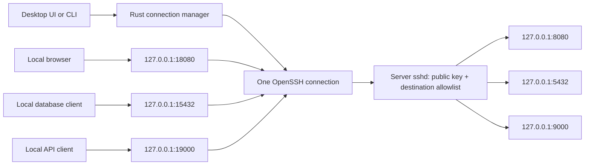

# sservcli

Access several services on one server through one authenticated SSH connection.
sservcli provides a Rust connection manager and CLI, a Tauri 2 desktop interface,
and an Ubuntu server provisioning tool. The server runs ordinary OpenSSH; there
is no additional network daemon or publicly exposed management API.

This is an OpenSSH-based MVP. Web services open in your browser, and database or
TCP services open in a configured local client. The application connects to
services that are **already running**; it does not start server processes or
grant a remote shell.

## Architecture



| Service | Server destination | Local endpoint |
| --- | --- | --- |
| Web dashboard | `127.0.0.1:8080` | `http://127.0.0.1:18080/` |
| PostgreSQL | `127.0.0.1:5432` | `127.0.0.1:15432` |
| REST API | `127.0.0.1:9000` | `http://127.0.0.1:19000/docs` |

All enabled forwards belong to a single SSH process. A private OpenSSH control
socket confirms successful authentication and listener setup. Keepalives detect
broken transports. Interrupted connections use bounded exponential backoff;
initial authentication, host-key, or listener failures stop immediately.

## Requirements

- **CLI:** Linux or macOS, OpenSSH client with control socket support, Rust 1.75+
  and Cargo to build. The core has no GTK, Node.js, or Tauri dependency.
- **Desktop:** Linux or macOS, current stable Rust, Node.js 20.19+ or 22.12+,
  and the [Tauri 2 platform prerequisites](https://v2.tauri.app/start/prerequisites/).
  Linux requires the GTK/WebKit development libraries listed there. Current
  Tauri dependencies may need a newer compiler than Tauri's original minimum.
- **Server provisioning:** Ubuntu with Python 3.10+, OpenSSH server, systemd,
  `useradd`, `userdel`, `pkill`, and root access. The default systemd unit is `ssh`.
- **Service clients:** Your browser, `psql`, or any other configured executable.

Windows support is not implemented in this MVP: the connection manager requires
Unix OpenSSH control sockets.

## Quick start

### 1. Create a client profile and SSH identity

On the client:

```sh
cp client/examples/services.json services.json
ssh-keygen -t ed25519 -f ~/.ssh/sservcli -C sservcli
ssh-add ~/.ssh/sservcli
```

Edit `services.json`: set `ssh.host` to your real server and `ssh.identity_file`
to `~/.ssh/sservcli`. Keep the private key on the client. An encrypted private key
must be unlocked in your local SSH Agent before connecting; sservcli never asks
for a passphrase. Set `identity_file` to `null` to use identities from SSH Agent
without selecting a particular file. Agent authentication does not require agent
forwarding, which remains disabled.

### 2. Provision the server

Transfer the public key (`sservcli.pub`), the profile, and this repository to the
server using an existing administrator connection. Client filesystem paths in
the profile are not used by the server tool. Review the destinations before
installing:

```sh
python3 server/sservcli_server.py render --config services.json
sudo python3 server/sservcli_server.py install \
  --config services.json --public-key /path/to/sservcli.pub
```

The tool creates a new `svc_tunnel` account, installs a root-controlled public key,
appends a managed SSH policy, checks `sshd -t` and effective `sshd -T` settings,
and reloads the SSH service. Existing users, homes, or managed account records
are never reused. Validation or reload failure restores the previous SSH config
and attempts to remove the newly created account. Installation does not change
your firewall or start any application service.

The existing Makefile interface is also available:

```sh
sudo make create PUBKEY_FILE=/path/to/sservcli.pub \
  PERMIT_OPEN="127.0.0.1:8080 127.0.0.1:5432 127.0.0.1:9000"
```

`make create` uses `TUNNEL_USER` and `PERMIT_OPEN`; it does not read `CONFIG`.
Use the Python command above when the JSON profile is your source of truth.
Only plain Ed25519 public keys are accepted by the provisioning tool.

### 3. Install a verified server host key

Obtain `/etc/ssh/ssh_host_ed25519_key.pub` and its fingerprint through your
administrator's trusted channel. The administrator can display the fingerprint:

```sh
sudo ssh-keygen -lf /etc/ssh/ssh_host_ed25519_key.pub
```

After verifying the transferred public key and fingerprint, install it on the
client. This example assumes the trusted copy is named `server-host-key.pub`:

```sh
ssh-keygen -lf server-host-key.pub
mkdir -p ~/.ssh
chmod 700 ~/.ssh
touch ~/.ssh/known_hosts
chmod 600 ~/.ssh/known_hosts
awk -v host="server.example.com" '{ print host " " $1 " " $2 }' \
  server-host-key.pub >> ~/.ssh/known_hosts
```

Replace the hostname with exactly `ssh.host`. For a nonstandard SSH port, use
`[server.example.com]:2222` as the host field. Keep `known_hosts_file` pointed at
this file. Unknown and changed host keys fail closed. The application never
automatically trusts scanned keys or edits your host-key database.

### 4. Run the client

```sh
cargo build --release
./target/release/sservcli check --config services.json
./target/release/sservcli list --config services.json
./target/release/sservcli connect --config services.json
```

Keep the client running while using your services. Press Ctrl+C to close the
connection and release all local ports. Open a service as soon as the tunnel is
ready:

```sh
./target/release/sservcli connect --config services.json --open dashboard
```

`--open` runs once after the initial connection, not after every reconnect.
Inspect the equivalent standalone SSH command without connecting:

```sh
./target/release/sservcli command --config services.json
```

### 5. Run the desktop interface

After installing Tauri's platform prerequisites:

```sh
cd client/desktop
npm ci
npm run dev
```

Open **Connection settings**, enter the profile's filesystem path, and click
**Load profile**. The built-in editor can validate and save a profile, including
its per-service `enabled` settings. Disconnect before editing. In **Services**,
click **Connect server**, then **Open service** or **Launch client**. The
**Connection log** shows the last 200 SSH messages in memory.

`npm run build` produces the native executable in
`client/desktop/src-tauri/target/release/`. Installer bundling is disabled; code
signing and platform installers are outside this MVP. Remote service pages open
in an external browser and do not receive access to the Tauri IPC bridge.

The default PostgreSQL example launches `psql`, which works in a terminal. From
the desktop, choose a GUI database client or an installed terminal emulator:

```json
"launch": ["x-terminal-emulator", "-e", "psql", "-h", "{host}", "-p", "{port}", "-U", "app", "app"]
```

## Profile reference

See [`client/examples/services.json`](client/examples/services.json) for the
complete dashboard, PostgreSQL, and API example. Unknown fields are rejected by
the client to catch misspelled settings.

| Field | Meaning |
| --- | --- |
| `version` | Schema version; currently `1` |
| `name` | Display name for this server |
| `ssh.host`, `ssh.port`, `ssh.user` | Actual hostname/IP, port (default `22`), dedicated account |
| `ssh.identity_file` | Private key or public identity file; `null` for agent selection |
| `ssh.known_hosts_file` | Required verified host-key database |
| `reconnect.enabled` | Retry interrupted established connections; default `true` |
| `reconnect.max_attempts` | Total retries per Connect action; default `5`, maximum `100` |
| `reconnect.initial_delay_secs` | First retry delay; default `2` |
| `reconnect.max_delay_secs` | Backoff cap; default `30`, maximum `300` |
| `services[].id`, `name` | Unique service id and display name |
| `services[].kind` | `web`, `api`, `database`, or `tcp` |
| `services[].remote_host` | Must be the literal `127.0.0.1` |
| `services[].remote_port` | Server port, `1–65535` |
| `services[].local_port` | Unique unprivileged client port, `1024–65535` |
| `services[].enabled` | Include in this connection; default `true` |
| `services[].scheme`, `path` | Browser URL scheme (`http`/`https`) and path; defaults `http`, `/` |
| `services[].launch` | Optional local executable/argument array; no shell expansion |

SSH paths are relative to the profile's directory; `~/` expands to your home
directory. Other environment-variable and SSH `%` token expansions are not
supported. SSH config files are deliberately ignored (`-F none`), so aliases,
ProxyJump, extra forwards, and `ProxyCommand` are not inherited.

Launch arguments accept `{host}`, `{port}`, and `{url}`. Executables are resolved
through your local `PATH` or an explicit path. Profiles with launch commands are
trusted local code: review them before opening a service. Store database and API
credentials in the service's own client or keychain, rather than in this file.
Web/API services without a launch array use `xdg-open` on Linux or `open` on
macOS; database/TCP services require a launch array to use the launch button.

Changing a client's destination does not authorize it on the server. The server
renderer includes **all** listed services, even those disabled in the UI; the
`enabled` flag is a client preference. To change authorization in this version,
remove and reinstall the managed account with the revised profile. This
disconnects its users. Use separate accounts/profiles for different access roles.

## Server administration and security

The generated policy enforces public-key authentication, `MaxSessions 0`, local
TCP forwarding only, and an exact `PermitOpen` allowlist. It disables password
and keyboard-interactive login, agent/X11/Unix-socket forwarding, PTYs, tunnels,
user RC execution, and reverse listeners. The authorized key independently uses
`restrict,port-forwarding,permitopen="..."` restrictions. OpenSSH documents that
[`MaxSessions 0` permits forwarding while denying shell and subsystem sessions](https://man.openbsd.org/sshd_config.5#MaxSessions).

Inspect the effective policy for your real client source address, especially if
the server already has `Match`, `Include`, `AllowUsers`, or `DenyUsers` rules:

```sh
sudo python3 server/sservcli_server.py audit --config services.json \
  --client-address 203.0.113.10
```

The installer audits `127.0.0.1` unless you pass `--client-address`. This checks
one connection context, not every possible address-specific Match rule.
Override `--sshd-config` or `--ssh-service` as needed. Concurrent provisioning
operations are serialized with a file lock. Root-owned metadata in
`/var/lib/sservcli` identifies accounts created by this tool.

Remove a managed account, its home, and its policy:

```sh
sudo python3 server/sservcli_server.py remove --user svc_tunnel
# Or: sudo make delete TUNNEL_USER=svc_tunnel
```

Removal denies new authentication, reloads the policy, stops existing account
processes, and deletes the managed account. Modified account identities or edited
managed blocks are refused. If policy cleanup fails after deletion, a denying
block and metadata remain for administrator recovery. Accounts created by the
original Makefile's `# BEGIN forwarding-only` policy are not adopted or deleted
by this tool; migrate them manually or use a new dedicated username.

Bind server applications to loopback and expose only SSH through your firewall.
SSH protects transport and restricts destinations; each application still needs
its own authentication and authorization. Other processes running on the client
can reach its loopback ports, so service credentials remain necessary.

**Connected** means SSH authentication and listener setup succeeded. It does not
mean that a destination accepts connections or that an application is healthy.
OpenSSH's [`ExitOnForwardFailure` does not test ultimate destinations](https://man.openbsd.org/ssh_config.5#ExitOnForwardFailure).
Applications may need to reconnect or reload after a transport interruption.

## Development and verification

```sh
make check        # Example validation, policy rendering, JavaScript syntax
make test         # Rust unit tests + Python server transaction tests
make integration  # Real temporary OpenSSH daemon and loopback services
```

Integration tests require an installed OpenSSH server, a usable local user, and
the platform's SSH privilege-separation runtime directory (on Ubuntu,
`/run/sshd`, normally created by the OpenSSH service). They run without root,
create temporary keys/configuration, and never change your actual SSH config or
authorized keys. They exercise multiple forwards over one transport, verified
host keys, destination restrictions, shell/reverse-forwarding denial, clean
shutdown, reconnection, and retry exhaustion. Server transaction tests mock
account and systemd operations while using real temporary configuration files.

The CLI/core and native UI use separate Cargo workspaces so core tests can run
without desktop development libraries. On the initial development environment,
Rust 1.75 supports the CLI; the desktop requires a newer toolchain and installed
GTK/WebKit packages before it can be compiled and exercised.

```text
client/src/                  Shared Rust configuration, SSH supervisor, and CLI
client/examples/             Example connection profile
client/desktop/ui/           Local desktop interface (plain HTML/CSS/JavaScript)
client/desktop/src-tauri/    Tauri 2 command bridge and native application
server/sservcli_server.py   Server policy renderer, installer, auditor, remover
tests/                       Provisioning transactions and local SSH integration
```

Future extensions include a `russh` transport with direct TCP/IP channels for
built-in API/database modules, service-specific health checks, and multiple
simultaneous server profiles. These features are not implemented in this MVP.
